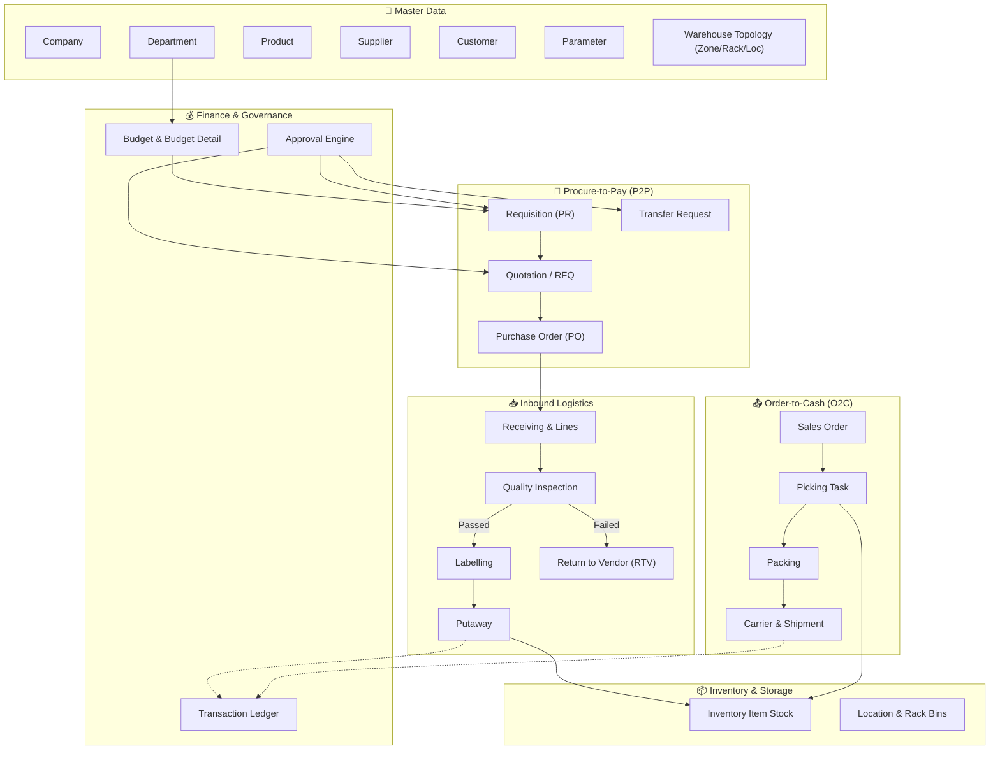
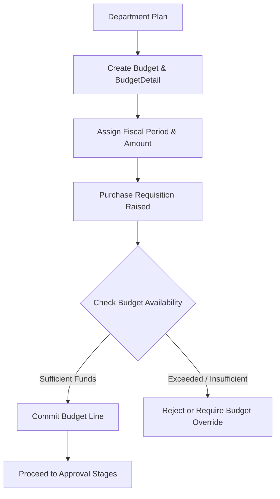
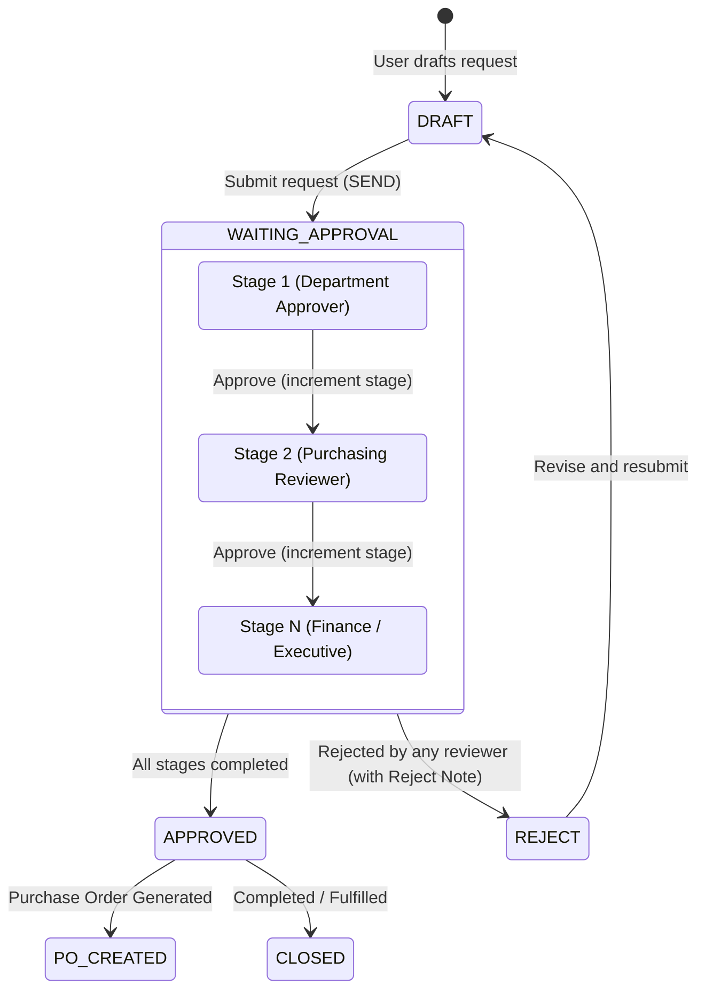
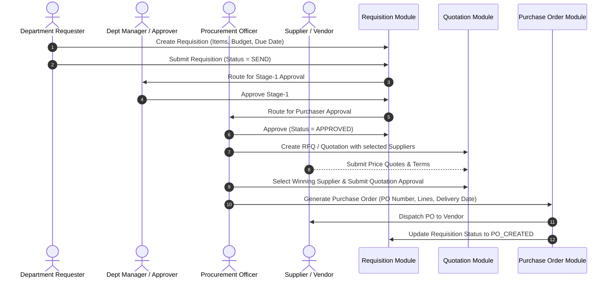
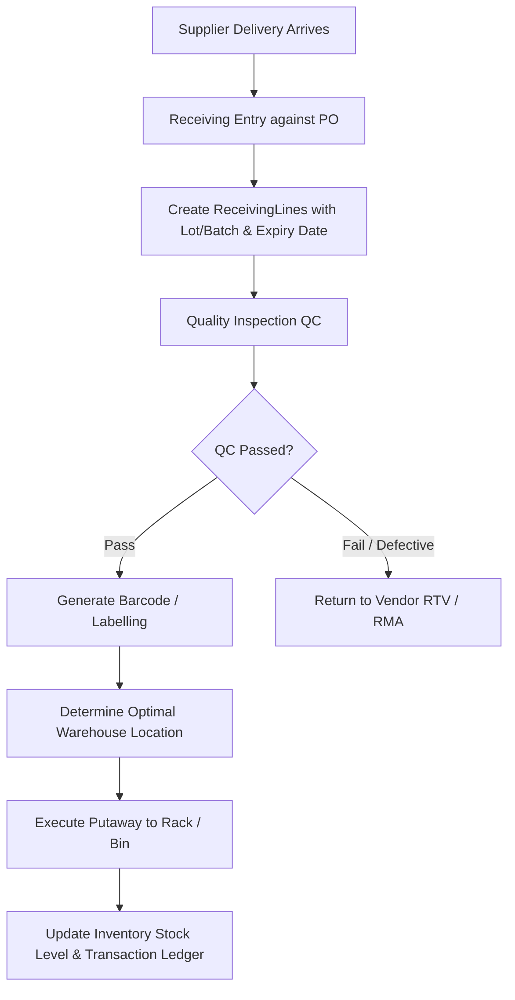
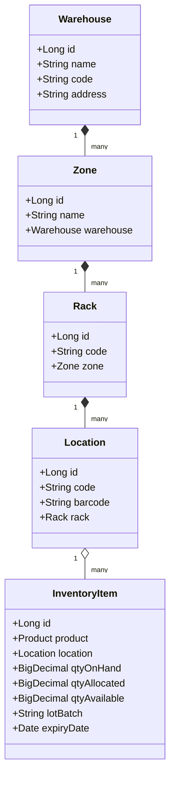
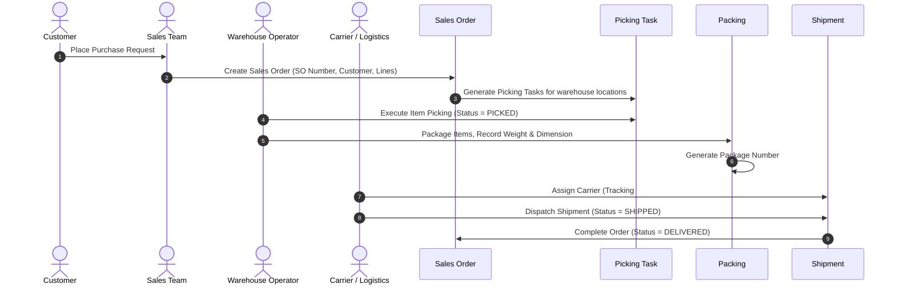
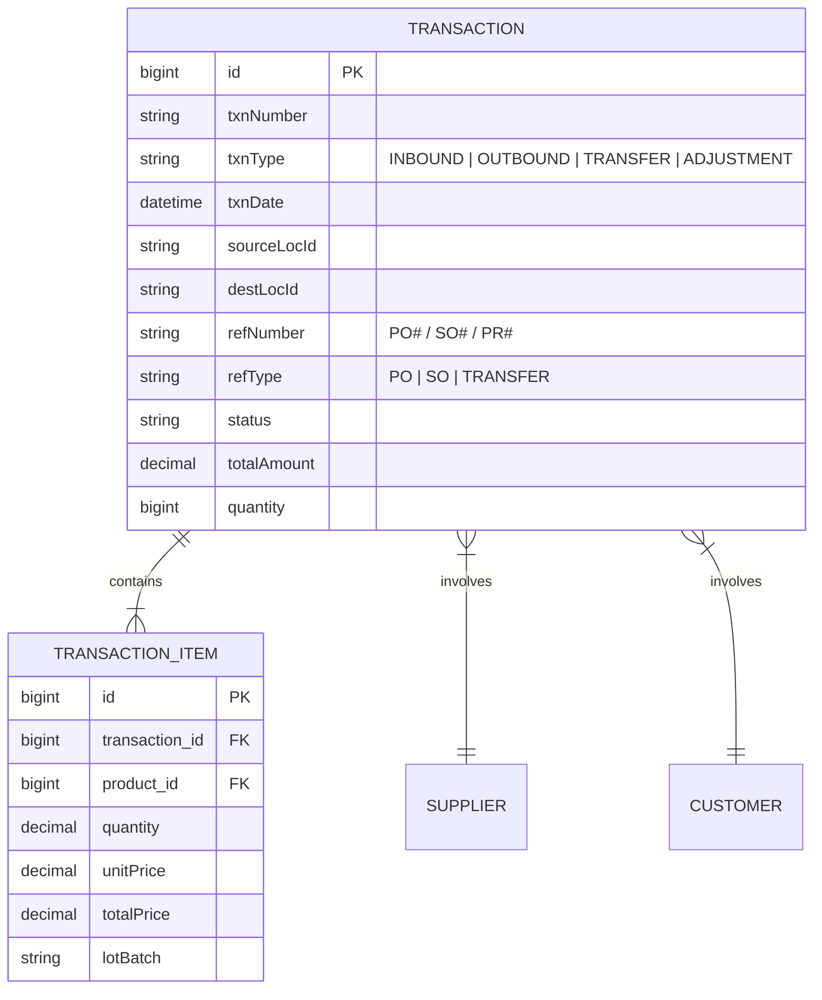
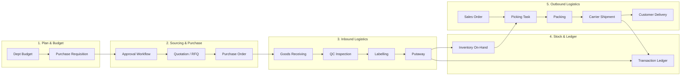

# Core ERP — Business Process Specification & Architecture

This document provides a comprehensive overview of the business processes, domain workflows, state machines, and cross-module interactions within the Core ERP system (`id.putra.core_erp.modules`).

---

## 📑 Table of Contents

- [Core ERP — Business Process Specification \& Architecture](#core-erp--business-process-specification--architecture)
  - [📑 Table of Contents](#-table-of-contents)
  - [1. System Overview \& Module Map](#1-system-overview--module-map)
  - [2. Master Data Management](#2-master-data-management)
  - [3. Budgeting \& Financial Control](#3-budgeting--financial-control)
    - [Key Rules](#key-rules)
  - [4. Multi-Stage Approval Workflow Engine](#4-multi-stage-approval-workflow-engine)
    - [Approval Entity Fields \& Semantics](#approval-entity-fields--semantics)
  - [5. Procure-to-Pay (P2P) Process](#5-procure-to-pay-p2p-process)
    - [Module States \& Enums](#module-states--enums)
  - [6. Inbound Warehouse Logistics Flow](#6-inbound-warehouse-logistics-flow)
    - [Inbound Operational Steps](#inbound-operational-steps)
  - [7. Inventory Management \& Stock Tracking](#7-inventory-management--stock-tracking)
    - [Stock Calculation Logic](#stock-calculation-logic)
  - [8. Order-to-Cash \& Outbound Fulfillment (O2C)](#8-order-to-cash--outbound-fulfillment-o2c)
    - [Outbound Workflow Stages](#outbound-workflow-stages)
  - [9. Transaction Ledger \& Audit Trail](#9-transaction-ledger--audit-trail)
    - [Transaction Types (`txnType`)](#transaction-types-txntype)
  - [10. End-to-End Integrated Lifecycle Diagram](#10-end-to-end-integrated-lifecycle-diagram)
  - [Summary of Key Entities by Module](#summary-of-key-entities-by-module)

---

## 1. System Overview & Module Map

The Core ERP system is architected as modular business domains handling procurement, warehousing, inventory management, sales fulfillment, budgeting, and approval hierarchies.

---

## 2. Master Data Management

Master Data acts as the single source of truth across all operational modules:

| Domain         | Entity                                                                                                                        | Purpose & Relationships                                                                                                                                                                                                                                                                                                                                                                                                                                                      |
| :------------- | :---------------------------------------------------------------------------------------------------------------------------- | :--------------------------------------------------------------------------------------------------------------------------------------------------------------------------------------------------------------------------------------------------------------------------------------------------------------------------------------------------------------------------------------------------------------------------------------------------------------------------- |
| **Company**    | [`Company`](file:///e:/Project/core-erp/src/main/java/id/putra/core_erp/modules/company/model/Company.java)                   | Legal entity configuration, tax details, corporate headquarters.                                                                                                                                                                                                                                                                                                                                                                                                             |
| **Department** | [`Department`](file:///e:/Project/core-erp/src/main/java/id/putra/core_erp/modules/department/model/Department.java)          | Organization structure (`dept_number`, code, manager), requisition originator, and cost center.                                                                                                                                                                                                                                                                                                                                                                              |
| **Parameter**  | [`ParameterLookup`](file:///e:/Project/core-erp/src/main/java/id/putra/core_erp/modules/parameter/model/ParameterLookup.java) | Dynamic lookup engine for system-wide configuration keys and codes.                                                                                                                                                                                                                                                                                                                                                                                                          |
| **Product**    | [`Product`](file:///e:/Project/core-erp/src/main/java/id/putra/core_erp/modules/product/model/Product.java)                   | Item catalog (SKU, barcode, name, unit of measure, category).                                                                                                                                                                                                                                                                                                                                                                                                                |
| **Supplier**   | [`Supplier`](file:///e:/Project/core-erp/src/main/java/id/putra/core_erp/modules/supplier/model/Supplier.java)                | Vendor profiles with contacts ([`SupplierContact`](file:///e:/Project/core-erp/src/main/java/id/putra/core_erp/modules/supplier/model/SupplierContact.java)), billing/shipping addresses ([`SupplierAddress`](file:///e:/Project/core-erp/src/main/java/id/putra/core_erp/modules/supplier/model/SupplierAddress.java)), and catalog mapping ([`ProductSupplier`](file:///e:/Project/core-erp/src/main/java/id/putra/core_erp/modules/supplier/model/ProductSupplier.java)). |
| **Customer**   | [`Customer`](file:///e:/Project/core-erp/src/main/java/id/putra/core_erp/modules/customer/model/Customer.java)                | Client directory with account contacts ([`ContactPersonCustomer`](file:///e:/Project/core-erp/src/main/java/id/putra/core_erp/modules/customer/model/ContactPersonCustomer.java)) and billing profiles.                                                                                                                                                                                                                                                                      |
| **Warehouse**  | [`Warehouse`](file:///e:/Project/core-erp/src/main/java/id/putra/core_erp/modules/warehouse/model/Warehouse.java)             | Physical storage topology: `Warehouse` &rarr; `Zone` &rarr; `Rack` &rarr; `Location` (Bin).                                                                                                                                                                                                                                                                                                                                                                                  |

---

## 3. Budgeting & Financial Control

The budget module ensures corporate spending governance prior to procurement commitment.

### Key Rules

1. Every Requisition can reference a [`Budget`](file:///e:/Project/core-erp/src/main/java/id/putra/core_erp/modules/budget/model/Budget.java) and `budget_detail_id`.
2. Requisitions track currency, total price, and allocated department cost centers.
3. Over-budget requests require executive approval or explicit budget variance authorization.

---

## 4. Multi-Stage Approval Workflow Engine

The Core ERP system utilizes a multi-stage approval engine supporting sequential hierarchy steps, purchaser reviews, permanent approvals, and bypass rules.

### Approval Entity Fields & Semantics

- **`currentApprovalStage`**: Current step index (0-based or 1-based index).
- **`totalApprovalStage`**: Total number of required approval milestones.
- **`lastApproved`**: Timestamp and identifier of the last authorized user.
- **`nextApprovals`**: List of eligible approval user identifiers or roles for the pending stage.
- **`isApprovalPermanent`** / **`isBypassPermanent`**: Direct routing flags for accelerated or automated approvals.

---

## 5. Procure-to-Pay (P2P) Process

The procurement module coordinates purchase requisitions, quotations/bidding, and purchase order creation.

### Module States & Enums

- [`RequisitionEnum`](file:///e:/Project/core-erp/src/main/java/id/putra/core_erp/modules/procurement/enums/RequisitionEnum.java):
  - `DRAFT` &rarr; `SEND` &rarr; `WAITING_APPROVAL` &rarr; `APPROVED` &rarr; `PO_CREATED` &rarr; `CLOSED` (or `REJECT`).
- [`Transfer`](file:///e:/Project/core-erp/src/main/java/id/putra/core_erp/modules/procurement/model/Transfer.java): Used for inter-departmental transfers and asset reallocation.

---

## 6. Inbound Warehouse Logistics Flow

When goods arrive from a supplier against a Purchase Order, the inbound receiving pipeline inspects, labels, and puts away items.

### Inbound Operational Steps

1. **Receiving (`Receiving`, `ReceivingLine`)**:
   - Records goods delivery against the PO number.
   - Captures `qtyReceived`, `lotBatch`, and `expiryDate`.
2. **Quality Inspection (`QualityInspection`)**:
   - Inspects physical items against standards.
   - Logs `result` (`PASSED`, `FAILED`, `CONDITIONAL`) and detailed `remarks`.
3. **Labelling (`Labelling`)**:
   - Assigns scannable labels, batch identifiers, and tracking codes.
4. **Putaway (`Putaway`)**:
   - Moves products from the receiving dock to assigned storage `Location` (Zone &rarr; Rack &rarr; Bin).
5. **Return to Vendor (`ReturnToVendor`, `Return`)**:
   - Isolates rejected goods and prepares vendor return documentation.

---

## 7. Inventory Management & Stock Tracking

The inventory module maintains accurate visibility over available, allocated, and physical stock.

### Stock Calculation Logic

$$\text{Quantity Available} = \text{Quantity On Hand} - \text{Quantity Allocated (Reserved for Outbound)}$$

- **Inbound Putaway**: Increases `qtyOnHand` and `qtyAvailable` in designated `Location`.
- **Sales Order Reservation**: Increases `qtyAllocated` and reduces `qtyAvailable`.
- **Picking & Dispatch**: Decreases `qtyOnHand` and `qtyAllocated`.

---

## 8. Order-to-Cash & Outbound Fulfillment (O2C)

The outbound module manages customer order capture, warehouse picking waves, packaging, carrier assignment, and final dispatch.

### Outbound Workflow Stages

1. **Sales Order (`SalesOrder`, `SalesOrderLine`)**: Customer demand confirmation.
2. **Picking (`PickingTask`)**: Directed picking from specific warehouse racks/bins.
3. **Packing (`Packing`)**: Packaging verification, weight/dimension recording, packing slip generation.
4. **Shipment (`Shipment`, `Carrier`)**: Carrier assignment, tracking manifest, and shipping event recording.

---

## 9. Transaction Ledger & Audit Trail

Every physical and monetary movement is logged immutably in the universal [`Transaction`](file:///e:/Project/core-erp/src/main/java/id/putra/core_erp/modules/transaction/model/Transaction.java) and [`TransactionItem`](file:///e:/Project/core-erp/src/main/java/id/putra/core_erp/modules/transaction/model/TransactionItem.java) tables.

### Transaction Types (`txnType`)

- `INBOUND_RECEIPT`: Stock added via purchase order receiving & putaway.
- `OUTBOUND_SHIPMENT`: Stock deducted via sales order shipment.
- `INTERNAL_TRANSFER`: Stock moved between warehouses or rack locations.
- `INVENTORY_ADJUSTMENT`: Cycle count or stock reconciliation adjustments.
- `RETURN_TO_VENDOR`: Defective item return to supplier.
- `CUSTOMER_RETURN`: Return from customer into quarantine/inspection location.

---

## 10. End-to-End Integrated Lifecycle Diagram

---

## Summary of Key Entities by Module

| Module Directory | Key Domain Models                                                                                                                                                                                                                                                                                                                                                                                                                                                                                                                                                                                                                                                                                                                  | Key Services & Responsibilities                                                   |
| :--------------- | :--------------------------------------------------------------------------------------------------------------------------------------------------------------------------------------------------------------------------------------------------------------------------------------------------------------------------------------------------------------------------------------------------------------------------------------------------------------------------------------------------------------------------------------------------------------------------------------------------------------------------------------------------------------------------------------------------------------------------------- | :-------------------------------------------------------------------------------- |
| `approval`       | [`Approval`](file:///e:/Project/core-erp/src/main/java/id/putra/core_erp/modules/approval/model/Approval.java)                                                                                                                                                                                                                                                                                                                                                                                                                                                                                                                                                                                                                     | Multi-stage routing, authorization limits, approval logging.                      |
| `budget`         | [`Budget`](file:///e:/Project/core-erp/src/main/java/id/putra/core_erp/modules/budget/model/Budget.java), [`BudgetDetail`](file:///e:/Project/core-erp/src/main/java/id/putra/core_erp/modules/budget/model/BudgetDetail.java), [`BudgetType`](file:///e:/Project/core-erp/src/main/java/id/putra/core_erp/modules/budget/model/BudgetType.java)                                                                                                                                                                                                                                                                                                                                                                                   | Department fiscal allocation, spending limits, budget check.                      |
| `procurement`    | [`Requisition`](file:///e:/Project/core-erp/src/main/java/id/putra/core_erp/modules/procurement/model/Requisition.java), [`Quotation`](file:///e:/Project/core-erp/src/main/java/id/putra/core_erp/modules/procurement/model/Quotation.java), [`Transfer`](file:///e:/Project/core-erp/src/main/java/id/putra/core_erp/modules/procurement/model/Transfer.java), [`Purchase`](file:///e:/Project/core-erp/src/main/java/id/putra/core_erp/modules/procurement/model/Purchase.java)                                                                                                                                                                                                                                                 | PR creation, vendor bidding, purchasing approval, asset transfer.                 |
| `inbound`        | [`PurchaseOrder`](file:///e:/Project/core-erp/src/main/java/id/putra/core_erp/modules/inbound/model/PurchaseOrder.java), [`Receiving`](file:///e:/Project/core-erp/src/main/java/id/putra/core_erp/modules/inbound/model/Receiving.java), [`QualityInspection`](file:///e:/Project/core-erp/src/main/java/id/putra/core_erp/modules/inbound/model/QualityInspection.java), [`Labelling`](file:///e:/Project/core-erp/src/main/java/id/putra/core_erp/modules/inbound/model/Labelling.java), [`Putaway`](file:///e:/Project/core-erp/src/main/java/id/putra/core_erp/modules/inbound/model/Putaway.java), [`ReturnToVendor`](file:///e:/Project/core-erp/src/main/java/id/putra/core_erp/modules/inbound/model/ReturnToVendor.java) | Dock receiving, lot/expiry tracking, quality check, putaway to bins, RMA returns. |
| `inventory`      | [`InventoryItem`](file:///e:/Project/core-erp/src/main/java/id/putra/core_erp/modules/inventory/model/InventoryItem.java)                                                                                                                                                                                                                                                                                                                                                                                                                                                                                                                                                                                                          | Real-time stock on hand, allocated quantities, lot balances.                      |
| `outbound`       | [`SalesOrder`](file:///e:/Project/core-erp/src/main/java/id/putra/core_erp/modules/outbound/model/SalesOrder.java), [`PickingTask`](file:///e:/Project/core-erp/src/main/java/id/putra/core_erp/modules/outbound/model/PickingTask.java), [`Packing`](file:///e:/Project/core-erp/src/main/java/id/putra/core_erp/modules/outbound/model/Packing.java), [`Carrier`](file:///e:/Project/core-erp/src/main/java/id/putra/core_erp/modules/outbound/model/Carrier.java), [`Shipment`](file:///e:/Project/core-erp/src/main/java/id/putra/core_erp/modules/outbound/model/Shipment.java)                                                                                                                                               | Sales demand processing, wave picking, box packing, carrier dispatch.             |
| `transaction`    | [`Transaction`](file:///e:/Project/core-erp/src/main/java/id/putra/core_erp/modules/transaction/model/Transaction.java), [`TransactionItem`](file:///e:/Project/core-erp/src/main/java/id/putra/core_erp/modules/transaction/model/TransactionItem.java)                                                                                                                                                                                                                                                                                                                                                                                                                                                                           | Immutable audit log of all financial and physical movements.                      |
| `warehouse`      | [`Warehouse`](file:///e:/Project/core-erp/src/main/java/id/putra/core_erp/modules/warehouse/model/Warehouse.java), [`Zone`](file:///e:/Project/core-erp/src/main/java/id/putra/core_erp/modules/warehouse/model/Zone.java), [`Rack`](file:///e:/Project/core-erp/src/main/java/id/putra/core_erp/modules/warehouse/model/Rack.java), [`Location`](file:///e:/Project/core-erp/src/main/java/id/putra/core_erp/modules/warehouse/model/Location.java)                                                                                                                                                                                                                                                                               | Storage facility hierarchy, bin coordinates, warehouse contact persons.           |
| `master data`    | `company`, `department`, `customer`, `supplier`, `product`, `parameter`                                                                                                                                                                                                                                                                                                                                                                                                                                                                                                                                                                                                                                                            | Foundation master records utilized across all modules.                            |
| `dashboard`      | View aggregation layer                                                                                                                                                                                                                                                                                                                                                                                                                                                                                                                                                                                                                                                                                                             | Operational KPI analytics, pipeline summaries, alert queues.                      |
