# Core ERP — Business Process Specification & Architecture

This document provides a comprehensive overview of the business processes, domain workflows, state machines, dan cross-module interactions within the Core ERP system (`id.putra.core_erp.modules`).

---

## 📑 Table of Contents

- [1. System Overview & Module Map](#1-system-overview--module-map)
- [2. Master Data Management](#2-master-data-management)
- [3. Budgeting & Financial Control](#3-budgeting--financial-control)
  - [Budget Allocation & Spend Checking Rules](#budget-allocation--spend-checking-rules)
- [4. Multi-Stage Approval Workflow Engine](#4-multi-stage-approval-workflow-engine)
  - [Approval Entity Fields & Semantics](#approval-entity-fields--semantics)
  - [Lifecycle & Transition Rules](#lifecycle--transition-rules)
- [5. Procure-to-Pay (P2P) Process](#5-procure-to-pay-p2p-process)
  - [Procurement Workflow Stages](#procurement-workflow-stages)
  - [Module States & Enums](#module-states--enums)
- [6. Inbound Warehouse Logistics Flow](#6-inbound-warehouse-logistics-flow)
  - [Inbound Operational Steps](#inbound-operational-steps)
- [7. Inventory Management & Stock Tracking](#7-inventory-management--stock-tracking)
  - [Stock Calculation Logic & Invariants](#stock-calculation-logic--invariants)
- [8. Order-to-Cash & Outbound Fulfillment (O2C)](#8-order-to-cash--outbound-fulfillment-o2c)
  - [Outbound Workflow Stages](#outbound-workflow-stages)
- [9. Transaction Ledger & Audit Trail](#9-transaction-ledger--audit-trail)
  - [Transaction Types (`txnType`)](#transaction-types-txntype)
- [10. End-to-End Integrated Lifecycle Diagram](#10-end-to-end-integrated-lifecycle-diagram)
- [11. Notification Content Approval Flow](#11-notification-content-approval-flow)
- [12. Summary of Key Entities by Module](#12-summary-of-key-entities-by-module)

---

## 1. System Overview & Module Map

The Core ERP system is architected as modular business domains handling procurement, warehousing, inventory management, sales fulfillment, budgeting, dan approval hierarchies.

```mermaid
graph TB
    subgraph MasterData ["🏢 Master Data"]
        MD_Comp["Company"]
        MD_Dept["Department"]
        MD_Prod["Product"]
        MD_Supp["Supplier"]
        MD_Cust["Customer"]
        MD_Param["ParameterLookup"]
        MD_WH["Warehouse Topology (Zone / Rack / Location)"]
    end

    subgraph Finance ["💰 Finance & Governance"]
        MOD_Budget["Budget & BudgetDetail"]
        MOD_Appr["Approval Engine"]
        MOD_Txn["Transaction Ledger"]
    end

    subgraph Procurement ["🛒 Procure-to-Pay (P2P)"]
        PR_Req["Requisition (PR)"]
        PR_Quote["Quotation / RFQ"]
        PR_Transfer["Transfer Request"]
        PR_PO["Purchase Order (PO)"]
    end

    subgraph Inbound ["📥 Inbound Logistics"]
        IN_Recv["Receiving & Lines"]
        IN_QC["Quality Inspection"]
        IN_Label["Labelling"]
        IN_Putaway["Putaway"]
        IN_RTV["Return to Vendor (RTV)"]
    end

    subgraph Inventory ["📦 Inventory & Storage"]
        INV_Item["InventoryItem (Stock Balances)"]
        INV_Loc["Location & Rack Bins"]
    end

    subgraph Outbound ["📤 Order-to-Cash (O2C)"]
        OUT_SO["Sales Order"]
        OUT_Pick["Picking Task"]
        OUT_Pack["Packing"]
        OUT_Ship["Carrier & Shipment"]
    end

    %% Core Dependencies (Simplified)
    MD_Dept --> MOD_Budget
    MOD_Appr --> PR_Req
    MOD_Appr --> PR_Quote
    IN_Recv & OUT_SO --> INV_Item
    OUT_Ship --> MOD_Txn
```



## 2. Master Data Management

The Core ERP utilizes several foundational master data domains which feed into multiple operational workflows:
*   **Company/Department:** Defines organizational structure and cost center attribution.
*   **Product:** The central record for goods, including SKU, dimensions, dan unit of measure (UoM).
*   **Customer & Supplier:** Records detailing counterparty information necessary for transactions. 

---

## 5. Procure-to-Pay (P2P) Process

This workflow manages the acquisition of goods and services, starting from identifying a need to receiving the items.

### Procurement Workflow Stages

The standard P2P flow proceeds as follows:
1. **Requisition**: User submits a requirement based on budget atau operational need. Status: `DRAFT` $\rightarrow$ `PENDING_APPROVAL`.
2. **Quotation/RFQ**: Sistem mencari harga terbaik dari vendor yang terdaftar untuk membandingkan penawaran.
3. **Purchase Order (PO)**: PO dibuat, dikirim, dan menjadi kontrak mengikat dengan Vendor (`id.putra...modules.inbound.model.PurchaseOrder`).
4. **Transfer Request**: Manajemen internal pergerakan stok antar departemen atau gudang yang disetujui secara manual.

### Module States & Enums
*   **Status:** Status PO/PR (e.g., `DRAFT`, `PENDING_APPROVAL`, `APPROVED`, `PO_SENT`).
*   **Key Entities:** 
    - [`Requisition`](file:///d:/Project/core-erp/src/main/java/id/putra/core_erp/modules/procurement/model/Requisition.java)
    - [`PurchaseOrder`](file:///d:/Project/core-erp/src/main/java/id/putra/core_erp/modules/inbound/model/PurchaseOrder.java) - *Received goods against this PO.*

---

## 6. Inbound Warehouse Logistics Flow

This module manages the entire lifecycle of goods entering the warehouse, memastikan akurasi dan kepatuhan.

### Inbound Operational Steps

1. **Receiving**: Goods are received against an existing Purchase Order (`id.putra...modules/inbound`). Data captured: `qtyReceived`, `lotBatch`, dan `expiryDate`.
2. **Quality Inspection (QC)**: Perlu dilakukan inspeksi fisik untuk memverifikasi barang. Status harus `PASSED` untuk melanjutkan putaway. [`QualityInspection`](file:///d:/Project/core-erp/src/main/java/id/putra/core_erp/modules/inbound/model/QualityInspection.java).
3. **Labelling**: Proses pencetakan dan penempelan label unik (seperti GTIN atau serial number) untuk setiap lot barang (`id.putra...modules/inbound/model/Labelling.java`).
4. **Putaway**: Barang dipindahkan secara fisik ke lokasi bin yang sesuai. Ini adalah proses *commit* pertama yang memperbarui saldo stok di `InventoryItem`. [`Putaway`](file:///d:/Project/core-erp/src/main/java/id/putra/core_erp/modules/inbound/model/Putaway.java).
5. **Return to Vendor (RTV)**: Proses penanganan barang yang perlu dikirim kembali ke supplier, dicatat sebagai transaksi terpisah.

---

## 7. Inventory Management & Stock Tracking

The system maintains a real-time, atomic view of stock across all physical locations and dimensions (Lot/Batch/Serial).

**Key Formula:** $$\text{Available Stock} = \text{quantity (On Hand)} - \text{reservedQty (Allocated for Outbound)}$$

*   **Inbound Putaway**: Bertanggung jawab untuk meningkatkan saldo stok (`quantity`) dan memperbarui *master product balance* setelah QC & Labeling.
*   **Reservation**: Sistem secara otomatis akan menaikkan `reservedQty` pada `InventoryItem` ketika ada Sales Order yang dibuat, mencegah *over-selling*.
*   **Stock Adjustment/Cycle Counting**: Memungkinkan penyesuaian fisik stok dengan catatan audit lengkap. 

---

## 8. Order-to-Cash & Outbound Fulfillment (O2C)

This module manages the fulfillment process, from accepting a customer order to generating shipment proof.

### Outbound Workflow Stages

The process starts from the sales order and concludes with dispatch:
1. **Sales Order**: Penerimaan permintaan pelanggan dan *trigger* untuk reservasi stok (`id.putra...modules/outbound`).
2. **Picking**: Generates tasks for warehouse staff to retrieve items from designated locations, optimizing routes (WMS-like functionality). [`PickingTask`](file:///d:/Project/core-erp/src/main/java/id/putra/core_erp/modules/outbound/model/PickingTask.java).
3. **Packing**: Physical verification of picked items, recording dimensional data (weight/volume), dan generating packing slips.
4. **Shipment**: Final handoff ke kurir. Ini adalah langkah kritis yang secara permanen mengurangi stok (`InventoryItem`) dan mencatat event pengiriman final di `Transaction` Ledger. [`id.putra...modules/outbound/model/Shipment.java`].

---

## 9. Transaction Ledger & Audit Trail

Every physical, financial, atau monetary movement (e.g., Stock Increase, Payment Received, PO Creation) **must** be logged immutably di universal tables: [`Transaction`](file:///d:/Project/core-erp/src/main/java/id/putra/core_erp/modules/transaction/model/Transaction.java) dan [`TransactionItem`](file:///d:/Project/core-erp/src/main/java/id/putra/core_erp/modules/transaction/model/TransactionItem.java).

*   **Prinsip:** Auditability is key. Tidak ada *delete*, hanya *reversal* dengan catatan transaksi baru.
*   **Fungsi:** Sumber kebenaran (Single Source of Truth) untuk semua laporan keuangan dan inventaris historis.

---

## 10. End-to-End Integrated Lifecycle Diagram

(Diagram Mermaid yang menghubungkan P2P $\rightarrow$ Inbound $\rightarrow$ Inventory $\rightarrow$ Outbound, menunjukkan bagaimana data bergerak dan di-*commit* ke Transaction Ledger.)

---

## 11. Notification Content Approval Flow (NEW MODULE WORKFLOW)

The notification system is a critical communication channel for users and stakeholders. To maintain brand consistency, legal compliance, dan technical stability across various triggered messages (e.g., Welcome Email, Invoice Due Warning, Password Reset), all message templates and associated triggers must undergo a formal approval process *before* they are activated globally. This workflow ensures that the content is verified by multiple domains—Communication/Legal, Business Logic, dan Technical IT.

### Workflow Goal
To ensure that every piece of communication generated by the Core ERP system is approved for its final published version, thereby minimizing compliance risk dan maintaining a consistent user experience (UX).

### Approval Stages and Transition Rules
The workflow utilizes a sequential state machine pattern:

| Stage ID | Status Enum Value | Description | Aktor Bertanggung Jawab | Transisi Selanjutnya |
| :--- | :--- | :--- | :--- | :--- |
| **Draft** | `DRAFT` | Template notifikasi dibuat dan diunggah oleh pengguna. Hanya berisi konten mentah (teks, variabel). | Business Analyst / Developer | $\rightarrow$ Pending Review |
| **Pending Content Review**| `PENDING_REVIEW` | Konten ditinjau dari aspek *tone of voice*, tata bahasa (grammar), dan kepatuhan legal/komunikasi. | Communication Team / Legal | $\rightarrow$ Approved / Rejected |
| **Pending Technical Validation**| `PENDING_TECHNICAL_APPROVAL` | Memastikan bahwa semua variabel placeholder (${user\_name}, ${invoice\_id}) benar-benar dapat dipetakan (mapped) dari *source* sistem dan secara teknis valid. | IT Admin / Solution Architect | $\rightarrow$ Ready to Use / Rejected |
| **Ready to Use** | `ACTIVE` | Semua tahapan disetujui. Notifikasi dapat diaktifkan secara global, terintegrasi dengan trigger event. | System Owner (Final) | - |

### Data Model Implications 
Untuk mendukung *flow* ini, sistem harus melacak:

*   **Template Metadata:** Harus mencakup `template_id`, `current_status`, dan daftar riwayat persetujuan (`approval_history`).
*   **Audit Trail:** Setiap perubahan status harus dicatat dengan siapa yang menyetujui/menolak (`approver_user`), pada tanggal berapa, serta kolom alasan (reason) untuk penolakan.

---

## 12. Summary of Key Entities by Module

| Module | Key Model Classes / Entities |
| :--- | :--- |
| **Master Data** | `Company`, `Department`, `Product`, `Customer`, `Supplier` |
| **Finance/Approval** | `Budget`, `Transaction`, `WorkflowRequest` |
| **Procurement (P2P)** | `Requisition`, `Quotation`, `PurchaseOrder`, `TransferRequest` |
| **Inbound Logistics** | `Receiving`, `QualityInspection`, `Labelling`, `Putaway`, `ReturnToVendor` |
| **Inventory** | `InventoryItem`, `Location`, `Product` (Stock Tracking) |
| **Outbound (O2C)** | `SalesOrder`, `PickingTask`, `Packing`, `Shipment` |
| **Transaction Ledger** | `Transaction`, `TransactionItem` |
```