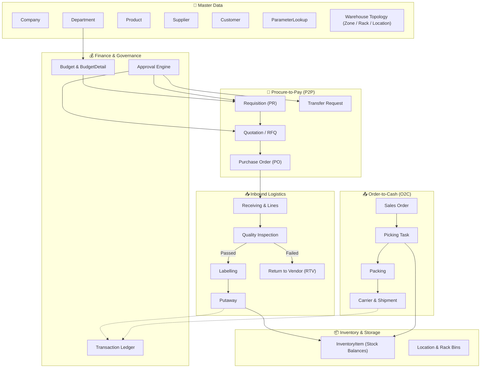
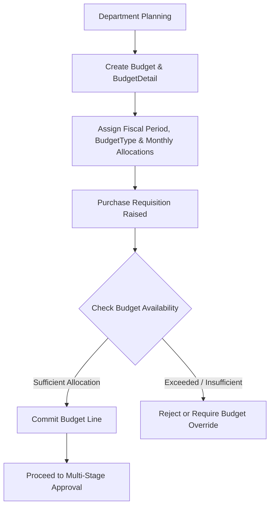
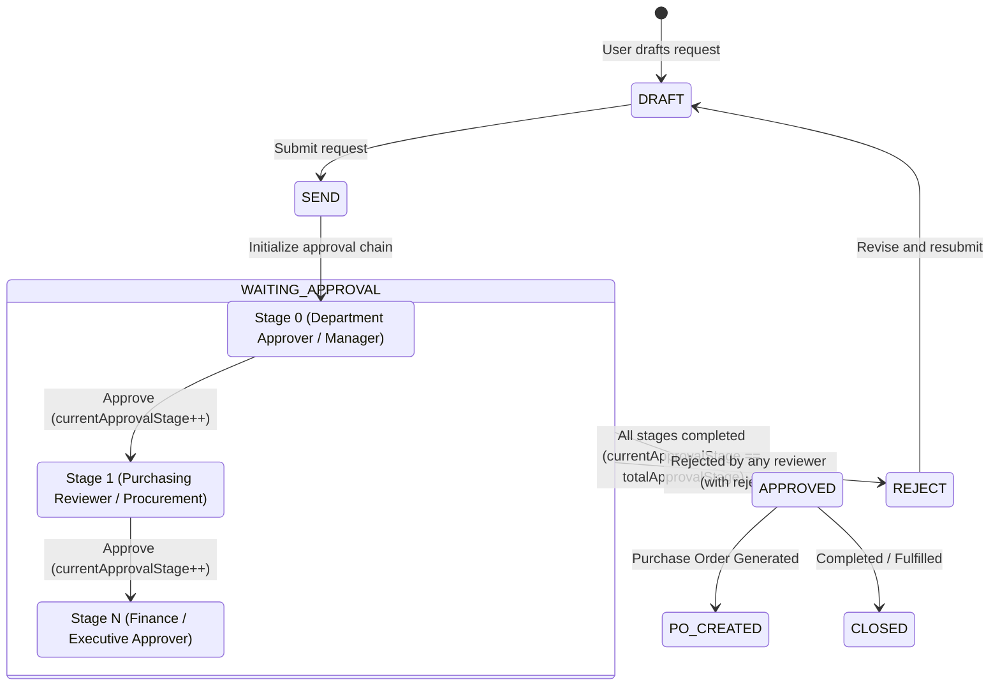
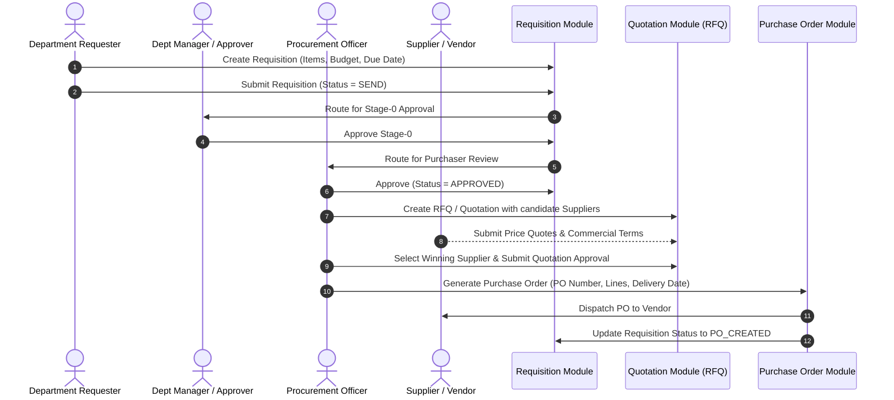
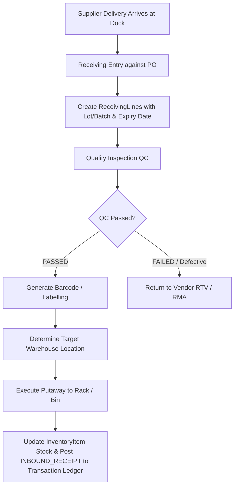
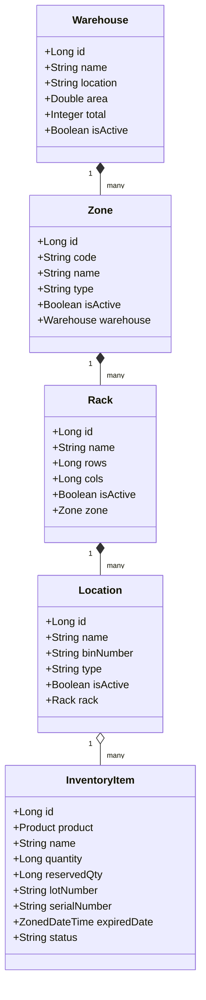
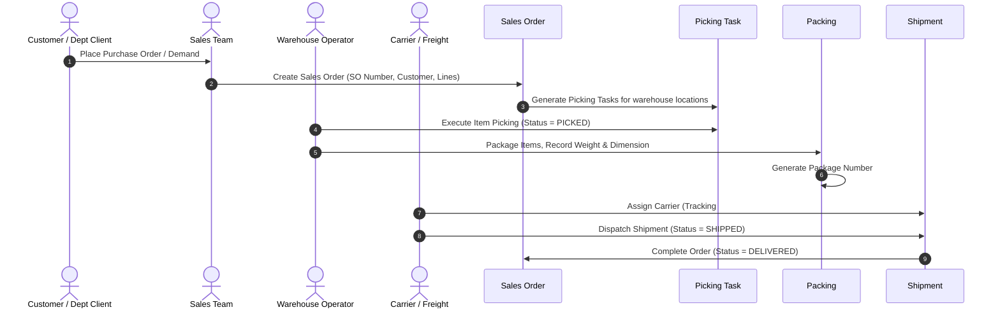
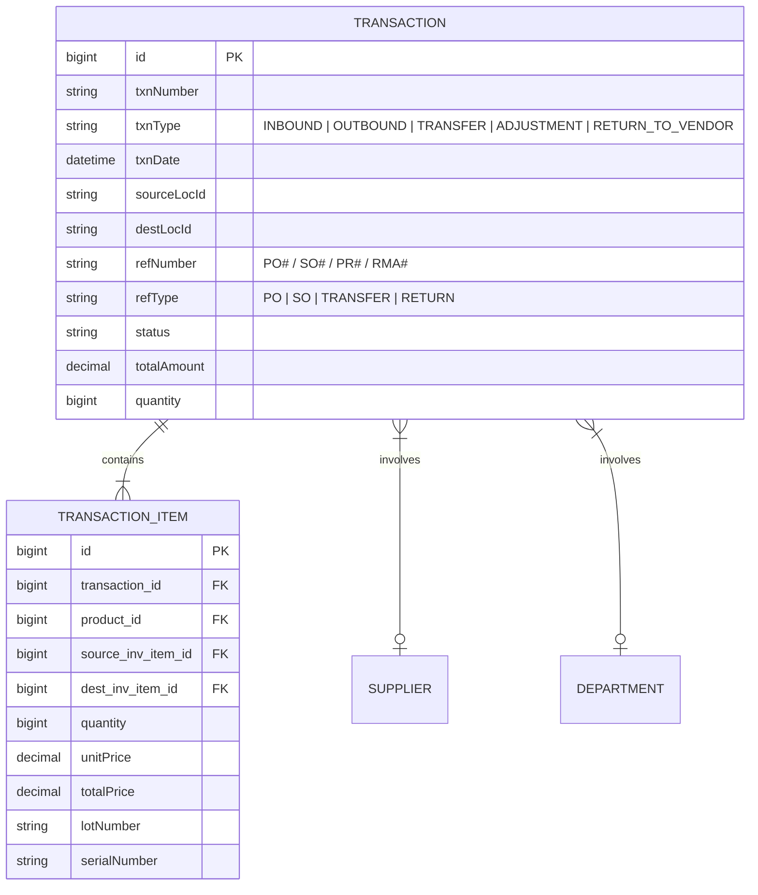
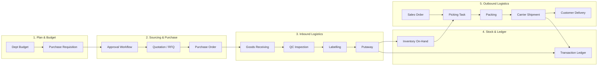

# Core ERP — Business Process Specification & Architecture

This document provides a comprehensive overview of the business processes, domain workflows, state machines, and cross-module interactions within the Core ERP system (`id.putra.core_erp.modules`).

---

## 📑 Table of Contents

- [1. System Overview & Module Map](#1-system-overview--module-map)
- [2. Master Data Management](#2-master-data-management)
- [3. Budgeting & Financial Control](#3-budgeting--financial-control)
  - [Budget Allocation & Spend Checking Rules](#budget-allocation--spend-checking-rules)
- [4. Multi-Stage Approval Workflow Engine](#4-multi-stage-approval-workflow-engine)
  - [Approval Entity Fields & Semantics](#approval-entity-fields--semantics)
  - [Lifecycle & Transition Rules](#lifecycle--transition-rules)
- [5. Procure-to-Pay (P2P) Process](#5-procure-to-pay-p2p-process)
  - [Procurement Workflow Stages](#procurement-workflow-stages)
  - [Module States & Enums](#module-states--enums)
- [6. Inbound Warehouse Logistics Flow](#6-inbound-warehouse-logistics-flow)
  - [Inbound Operational Steps](#inbound-operational-steps)
- [7. Inventory Management & Stock Tracking](#7-inventory-management--stock-tracking)
  - [Stock Calculation Logic & Invariants](#stock-calculation-logic--invariants)
- [8. Order-to-Cash & Outbound Fulfillment (O2C)](#8-order-to-cash--outbound-fulfillment-o2c)
  - [Outbound Workflow Stages](#outbound-workflow-stages)
- [9. Transaction Ledger & Audit Trail](#9-transaction-ledger--audit-trail)
  - [Transaction Types (`txnType`)](#transaction-types-txntype)
- [10. End-to-End Integrated Lifecycle Diagram](#10-end-to-end-integrated-lifecycle-diagram)
- [11. Summary of Key Entities by Module](#11-summary-of-key-entities-by-module)

---

## 1. System Overview & Module Map

The Core ERP system is architected as modular business domains handling procurement, warehousing, inventory management, sales fulfillment, budgeting, and approval hierarchies.

---

## 2. Master Data Management

Master Data acts as the single source of truth across all operational modules:

| Domain | Entity | Purpose & Relationships |
| :--- | :--- | :--- |
| **Company** | [`Company`](file:///d:/Project/core-erp/src/main/java/id/putra/core_erp/modules/company/model/Company.java) | Legal entity configuration, tax identifiers (`npwp`), corporate bank account (`accountBank`), operating currencies (`curr`), and approval policy settings. |
| **Department** | [`Department`](file:///d:/Project/core-erp/src/main/java/id/putra/core_erp/modules/department/model/Department.java) | Organization structure (`code` / `dept_number`, `name`), cost center, manager (`deptManager`), purchaser (`deptPurchaser`), executive (`approvalPresident`), and default approval chains (`approvals`). |
| **Parameter** | [`ParameterLookup`](file:///d:/Project/core-erp/src/main/java/id/putra/core_erp/modules/parameter/model/ParameterLookup.java) | Dynamic lookup engine for system-wide configuration keys, modules, values, and operational flags. |
| **Product** | [`Product`](file:///d:/Project/core-erp/src/main/java/id/putra/core_erp/modules/product/model/Product.java) | Central item catalog with `sku`, `name`, on-hand `quantity`, safety reorder threshold (`minStock`), and capacity ceiling (`maxStock`). |
| **Supplier** | [`Supplier`](file:///d:/Project/core-erp/src/main/java/id/putra/core_erp/modules/supplier/model/Supplier.java) | Vendor profiles with code, contact email, telephone, billing/shipping address, notes, and active status. |
| **Customer** | [`Customer`](file:///d:/Project/core-erp/src/main/java/id/putra/core_erp/modules/customer/model/Customer.java) | Client directory with account contact details, email, phone number, address, and active status. |
| **Warehouse Topology** | [`Warehouse`](file:///d:/Project/core-erp/src/main/java/id/putra/core_erp/modules/warehouse/model/Warehouse.java) | Multi-tier physical storage hierarchy: `Warehouse` &rarr; [`Zone`](file:///d:/Project/core-erp/src/main/java/id/putra/core_erp/modules/warehouse/model/Zone.java) &rarr; [`Rack`](file:///d:/Project/core-erp/src/main/java/id/putra/core_erp/modules/warehouse/model/Rack.java) &rarr; [`Location`](file:///d:/Project/core-erp/src/main/java/id/putra/core_erp/modules/warehouse/model/Location.java) (Bin coordinate). |

---

## 3. Budgeting & Financial Control

The budget module ensures corporate spending governance prior to procurement commitment.

### Budget Allocation & Spend Checking Rules

1. Every [`Requisition`](file:///d:/Project/core-erp/src/main/java/id/putra/core_erp/modules/procurement/model/Requisition.java) can reference a [`Budget`](file:///d:/Project/core-erp/src/main/java/id/putra/core_erp/modules/budget/model/Budget.java) and `budgetDetailId`.
2. [`BudgetDetail`](file:///d:/Project/core-erp/src/main/java/id/putra/core_erp/modules/budget/model/BudgetDetail.java) categorizes expenditures (`OPEX`, `CAPEX`, `EXPENSE`) and stores periodic milestones as [`BudgetAllocation`](file:///d:/Project/core-erp/src/main/java/id/putra/core_erp/modules/budget/model/BudgetAllocation.java) entries (`date`, `plan`, `actual`).
3. Requisitions track currency, total price, and allocated department cost centers.
4. Over-budget requests require executive approval or explicit budget variance authorization.

---

## 4. Multi-Stage Approval Workflow Engine

The Core ERP system utilizes a multi-stage approval engine supporting sequential hierarchy steps, purchaser reviews, permanent approvals, and bypass rules.

### Approval Entity Fields & Semantics

- **`stage`**: Step index in the sequence (0-based: 0, 1, 2, ...).
- **`users`**: NRP / Identifier of the authorized approver.
- **`currentApprovalStage`**: Current active stage index.
- **`totalApprovalStage`**: Total number of required approval milestone stages.
- **`lastApproved`**: Identifier and timestamp of the last authorized approver.
- **`nextApprovals`**: List of eligible approval user identifiers or roles for the pending stage.
- **`isApprovalPermanent`** / **`isBypassPermanent`**: Direct routing flags for accelerated or automated signoff.

### Lifecycle & Transition Rules

1. **Chain Cloning**: Requisitions and RFQs snapshot their approval chains from `Department.approvals` upon submission (`status = SEND`).
2. **Sequential Gate**: A stage must be signed off before the next stage is unlocked.
3. **Rejection**: Any approver can reject the request by submitting a `rejectNote`, moving status immediately to `REJECT`.
4. **Purchaser Authorization**: In addition to line managers, procurement validation is enforced via `temp_purchaser_approval` / `purchaser`.

---

## 5. Procure-to-Pay (P2P) Process

The procurement module coordinates purchase requisitions, quotations/bidding, and purchase order creation.

### Procurement Workflow Stages

1. **Purchase Requisition ([`Requisition`](file:///d:/Project/core-erp/src/main/java/id/putra/core_erp/modules/procurement/model/Requisition.java), [`RequisitionDetail`](file:///d:/Project/core-erp/src/main/java/id/putra/core_erp/modules/procurement/model/RequisitionDetail.java))**:
   - Internal request specifying items, quantities, estimated prices, budget reference, and justification.
2. **Request for Quotation ([`Quotation`](file:///d:/Project/core-erp/src/main/java/id/putra/core_erp/modules/procurement/model/Quotation.java))**:
   - Solicits competitive pricing from multiple candidate suppliers.
3. **Purchase Order ([`PurchaseOrder`](file:///d:/Project/core-erp/src/main/java/id/putra/core_erp/modules/inbound/model/PurchaseOrder.java), [`PurchaseOrderLine`](file:///d:/Project/core-erp/src/main/java/id/putra/core_erp/modules/inbound/model/PurchaseOrderLine.java))**:
   - Legally binding purchase contract sent to selected vendor.
4. **Transfer Request ([`Transfer`](file:///d:/Project/core-erp/src/main/java/id/putra/core_erp/modules/procurement/model/Transfer.java), [`TransferDetail`](file:///d:/Project/core-erp/src/main/java/id/putra/core_erp/modules/procurement/model/TransferDetail.java))**:
   - Internal transfers of inventory and assets between facilities or departments.

### Module States & Enums

- **Requisition States**: `DRAFT` &rarr; `SEND` &rarr; `APPROVED` &rarr; `PO_CREATED` &rarr; `CLOSED` (or `REJECT`).
- **Purchase Order States ([`OrderStatus`](file:///d:/Project/core-erp/src/main/java/id/putra/core_erp/enums/OrderStatus.java))**:
  - `DRAFT` &rarr; `SUBMITTED` &rarr; `CONFIRMED` &rarr; `PROCESSING` &rarr; `SHIPPED` &rarr; `DELIVERED` &rarr; `CLOSED` (or `CANCELLED`, `REJECTED`, `ON_HOLD`).

---

## 6. Inbound Warehouse Logistics Flow

When goods arrive from a supplier against a Purchase Order, the inbound receiving pipeline inspects, labels, and puts away items.

### Inbound Operational Steps

1. **Receiving ([`Receiving`](file:///d:/Project/core-erp/src/main/java/id/putra/core_erp/modules/inbound/model/Receiving.java), [`ReceivingLine`](file:///d:/Project/core-erp/src/main/java/id/putra/core_erp/modules/inbound/model/ReceivingLine.java))**:
   - Records goods delivery against the PO number.
   - Captures `qtyReceived`, `lotBatch`, and `expiryDate`.
2. **Quality Inspection ([`QualityInspection`](file:///d:/Project/core-erp/src/main/java/id/putra/core_erp/modules/inbound/model/QualityInspection.java))**:
   - Inspects physical items against standards.
   - Logs `result` (`PASSED`, `FAILED`, `CONDITIONAL`) and detailed `remarks`.
3. **Labelling ([`Labelling`](file:///d:/Project/core-erp/src/main/java/id/putra/core_erp/modules/inbound/model/Labelling.java))**:
   - Assigns scannable labels, batch identifiers, and tracking codes.
4. **Putaway ([`Putaway`](file:///d:/Project/core-erp/src/main/java/id/putra/core_erp/modules/inbound/model/Putaway.java))**:
   - Moves products from receiving dock to assigned storage `Location` (Zone &rarr; Rack &rarr; Bin).
5. **Return to Vendor ([`ReturnToVendor`](file:///d:/Project/core-erp/src/main/java/id/putra/core_erp/modules/inbound/model/ReturnToVendor.java), [`Return`](file:///d:/Project/core-erp/src/main/java/id/putra/core_erp/modules/inbound/model/Return.java))**:
   - Isolates rejected goods and prepares vendor return documentation.

---

## 7. Inventory Management & Stock Tracking

The inventory module maintains accurate visibility over available, allocated, and physical stock.

### Stock Calculation Logic & Invariants

$$\text{Available Stock} = \text{quantity (On Hand)} - \text{reservedQty (Allocated for Outbound)}$$

- **Inbound Putaway**: Increments `quantity` on [`InventoryItem`](file:///d:/Project/core-erp/src/main/java/id/putra/core_erp/modules/inventory/model/InventoryItem.java) and updates [`Product.quantity`](file:///d:/Project/core-erp/src/main/java/id/putra/core_erp/modules/product/model/Product.java).
- **Sales Order Reservation**: Increases `reservedQty`, reducing available stock without moving physical goods yet.
- **Picking & Dispatch**: Decreases `quantity` and `reservedQty` upon confirmed shipment.

---

## 8. Order-to-Cash & Outbound Fulfillment (O2C)

The outbound module manages customer order capture, warehouse picking waves, packaging, carrier assignment, and final dispatch.

### Outbound Workflow Stages

1. **Sales Order ([`SalesOrder`](file:///d:/Project/core-erp/src/main/java/id/putra/core_erp/modules/outbound/model/SalesOrder.java), [`SalesOrderLine`](file:///d:/Project/core-erp/src/main/java/id/putra/core_erp/modules/outbound/model/SalesOrderLine.java))**: Customer demand confirmation and stock reservation.
2. **Picking ([`PickingTask`](file:///d:/Project/core-erp/src/main/java/id/putra/core_erp/modules/outbound/model/PickingTask.java))**: Directed picking from specific warehouse racks/bins.
3. **Packing ([`Packing`](file:///d:/Project/core-erp/src/main/java/id/putra/core_erp/modules/outbound/model/Packing.java))**: Packaging verification, weight/dimension recording, packing slip generation.
4. **Shipment ([`Shipment`](file:///d:/Project/core-erp/src/main/java/id/putra/core_erp/modules/outbound/model/Shipment.java), [`Carrier`](file:///d:/Project/core-erp/src/main/java/id/putra/core_erp/modules/outbound/model/Carrier.java))**: Carrier assignment, tracking manifest, and shipping event recording.

---

## 9. Transaction Ledger & Audit Trail

Every physical and monetary movement is logged immutably in the universal [`Transaction`](file:///d:/Project/core-erp/src/main/java/id/putra/core_erp/modules/transaction/model/Transaction.java) and [`TransactionItem`](file:///d:/Project/core-erp/src/main/java/id/putra/core_erp/modules/transaction/model/TransactionItem.java) tables.

### Transaction Types (`txnType`)

- `INBOUND_RECEIPT`: Stock added via purchase order receiving & putaway.
- `OUTBOUND_SHIPMENT`: Stock deducted via sales order shipment.
- `INTERNAL_TRANSFER`: Stock moved between warehouses or rack locations.
- `INVENTORY_ADJUSTMENT`: Cycle count or stock reconciliation adjustments.
- `RETURN_TO_VENDOR`: Defective item return to supplier.
- `CUSTOMER_RETURN`: Return from customer into quarantine/inspection location.

---

## 10. End-to-End Integrated Lifecycle Diagram

---

## 11. Summary of Key Entities by Module

| Module Directory | Key Domain Models | Key Services & Responsibilities |
| :--- | :--- | :--- |
| `approval` | [`Approval`](file:///d:/Project/core-erp/src/main/java/id/putra/core_erp/modules/approval/model/Approval.java) | Multi-stage routing, authorization limits, approval logging. |
| `budget` | [`Budget`](file:///d:/Project/core-erp/src/main/java/id/putra/core_erp/modules/budget/model/Budget.java), [`BudgetDetail`](file:///d:/Project/core-erp/src/main/java/id/putra/core_erp/modules/budget/model/BudgetDetail.java), [`BudgetAllocation`](file:///d:/Project/core-erp/src/main/java/id/putra/core_erp/modules/budget/model/BudgetAllocation.java), [`BudgetType`](file:///d:/Project/core-erp/src/main/java/id/putra/core_erp/modules/budget/model/BudgetType.java) | Department fiscal allocation, spending limits, budget availability checking. |
| `procurement` | [`Requisition`](file:///d:/Project/core-erp/src/main/java/id/putra/core_erp/modules/procurement/model/Requisition.java), [`RequisitionDetail`](file:///d:/Project/core-erp/src/main/java/id/putra/core_erp/modules/procurement/model/RequisitionDetail.java), [`Quotation`](file:///d:/Project/core-erp/src/main/java/id/putra/core_erp/modules/procurement/model/Quotation.java), [`Transfer`](file:///d:/Project/core-erp/src/main/java/id/putra/core_erp/modules/procurement/model/Transfer.java), [`TransferDetail`](file:///d:/Project/core-erp/src/main/java/id/putra/core_erp/modules/procurement/model/TransferDetail.java), [`Item`](file:///d:/Project/core-erp/src/main/java/id/putra/core_erp/modules/procurement/model/Item.java), [`ItemMeasurement`](file:///d:/Project/core-erp/src/main/java/id/putra/core_erp/modules/procurement/model/ItemMeasurement.java), [`Inventory`](file:///d:/Project/core-erp/src/main/java/id/putra/core_erp/modules/procurement/model/Inventory.java) | PR creation, vendor bidding, purchasing approval, asset/stock transfer. |
| `inbound` | [`PurchaseOrder`](file:///d:/Project/core-erp/src/main/java/id/putra/core_erp/modules/inbound/model/PurchaseOrder.java), [`PurchaseOrderLine`](file:///d:/Project/core-erp/src/main/java/id/putra/core_erp/modules/inbound/model/PurchaseOrderLine.java), [`Receiving`](file:///d:/Project/core-erp/src/main/java/id/putra/core_erp/modules/inbound/model/Receiving.java), [`ReceivingLine`](file:///d:/Project/core-erp/src/main/java/id/putra/core_erp/modules/inbound/model/ReceivingLine.java), [`QualityInspection`](file:///d:/Project/core-erp/src/main/java/id/putra/core_erp/modules/inbound/model/QualityInspection.java), [`Labelling`](file:///d:/Project/core-erp/src/main/java/id/putra/core_erp/modules/inbound/model/Labelling.java), [`Putaway`](file:///d:/Project/core-erp/src/main/java/id/putra/core_erp/modules/inbound/model/Putaway.java), [`ReturnToVendor`](file:///d:/Project/core-erp/src/main/java/id/putra/core_erp/modules/inbound/model/ReturnToVendor.java), [`Return`](file:///d:/Project/core-erp/src/main/java/id/putra/core_erp/modules/inbound/model/Return.java) | Dock receiving, lot/expiry tracking, quality check, putaway to bins, RMA returns. |
| `inventory` | [`InventoryItem`](file:///d:/Project/core-erp/src/main/java/id/putra/core_erp/modules/inventory/model/InventoryItem.java) | Real-time stock on hand, allocated quantities, lot balances, serial tracking. |
| `outbound` | [`SalesOrder`](file:///d:/Project/core-erp/src/main/java/id/putra/core_erp/modules/outbound/model/SalesOrder.java), [`SalesOrderLine`](file:///d:/Project/core-erp/src/main/java/id/putra/core_erp/modules/outbound/model/SalesOrderLine.java), [`PickingTask`](file:///d:/Project/core-erp/src/main/java/id/putra/core_erp/modules/outbound/model/PickingTask.java), [`Packing`](file:///d:/Project/core-erp/src/main/java/id/putra/core_erp/modules/outbound/model/Packing.java), [`Carrier`](file:///d:/Project/core-erp/src/main/java/id/putra/core_erp/modules/outbound/model/Carrier.java), [`Shipment`](file:///d:/Project/core-erp/src/main/java/id/putra/core_erp/modules/outbound/model/Shipment.java) | Sales demand processing, wave picking, box packing, carrier dispatch. |
| `transaction` | [`Transaction`](file:///d:/Project/core-erp/src/main/java/id/putra/core_erp/modules/transaction/model/Transaction.java), [`TransactionItem`](file:///d:/Project/core-erp/src/main/java/id/putra/core_erp/modules/transaction/model/TransactionItem.java) | Immutable audit log of all financial and physical movements. |
| `warehouse` | [`Warehouse`](file:///d:/Project/core-erp/src/main/java/id/putra/core_erp/modules/warehouse/model/Warehouse.java), [`Zone`](file:///d:/Project/core-erp/src/main/java/id/putra/core_erp/modules/warehouse/model/Zone.java), [`Rack`](file:///d:/Project/core-erp/src/main/java/id/putra/core_erp/modules/warehouse/model/Rack.java), [`Location`](file:///d:/Project/core-erp/src/main/java/id/putra/core_erp/modules/warehouse/model/Location.java) | Storage facility hierarchy, bin coordinates, capacity management. |
| `master-data` | [`Company`](file:///d:/Project/core-erp/src/main/java/id/putra/core_erp/modules/company/model/Company.java), [`Department`](file:///d:/Project/core-erp/src/main/java/id/putra/core_erp/modules/department/model/Department.java), [`Customer`](file:///d:/Project/core-erp/src/main/java/id/putra/core_erp/modules/customer/model/Customer.java), [`Supplier`](file:///d:/Project/core-erp/src/main/java/id/putra/core_erp/modules/supplier/model/Supplier.java), [`Product`](file:///d:/Project/core-erp/src/main/java/id/putra/core_erp/modules/product/model/Product.java), [`ParameterLookup`](file:///d:/Project/core-erp/src/main/java/id/putra/core_erp/modules/parameter/model/ParameterLookup.java) | Foundation master records utilized across all modules. |
| `dashboard` | View aggregation layer | Operational KPI analytics, pipeline summaries, alert queues. |
